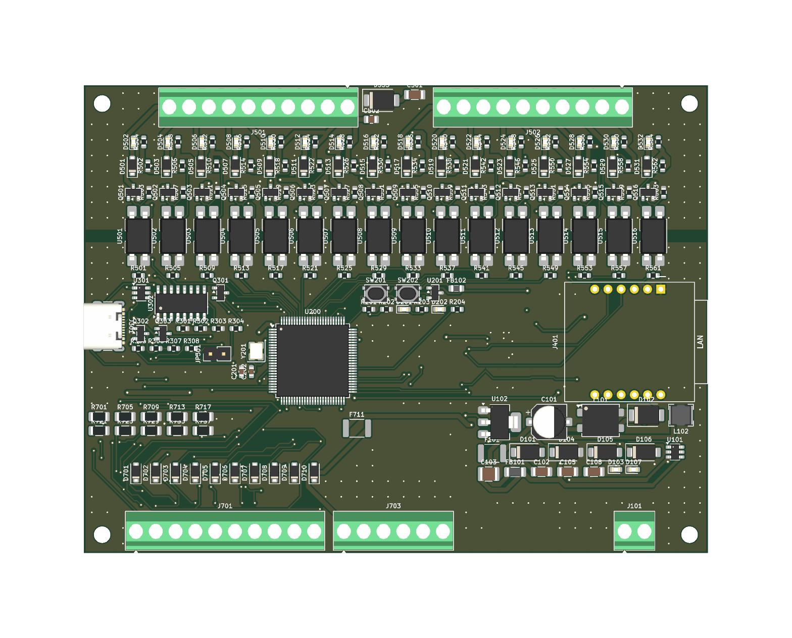

# PLC STM32F407VET6 – Modbus TCP – 16 DO transistor – 10 AI

Mạch nguyên lý KiCad 10 cho bộ PLC: điều khiển qua LAN bằng **Modbus TCP** (module W5500 Lite), nạp code qua **USB‑C (CH340C)**, 16 ngõ ra transistor cách ly quang, 10 ngõ vào analog **4–20mA**.

## Cấu trúc thư mục

| Đường dẫn | Nội dung |
|---|---|
| `kicad/PLC_STM32_Modbus.kicad_pro` | Project KiCad (mở file này) |
| `kicad/*.kicad_sch` | 6 trang mạch con (xem bảng dưới) |
| `kicad/PLC_STM32_Modbus.pdf` | Bản in PDF toàn bộ mạch |
| `kicad/BOM.csv` | Danh sách linh kiện (gom theo giá trị + footprint) |
| `kicad/erc.rpt` | Báo cáo ERC |
| `kicad/PLC_STM32_Modbus.kicad_pcb` | Mạch in 2 lớp 100×80mm |
| `kicad/fab/` | File sản xuất: Gerber + khoan (zip), file gắp đặt 2 mặt, PDF từng lớp, ảnh 3D |
| `gen/design.py`, `gen/kisch.py` | Script sinh mạch nguyên lý – sửa ở đây rồi chạy lại `sh gen/run.sh` |
| `gen/pcb.py`, `gen/finish.py`, `gen/fab.sh` | Script đặt linh kiện, nạp kết quả đi dây + đổ đồng, xuất file sản xuất |

> ⚠️ Các file `.kicad_sch` được **sinh tự động**. Nếu bạn sửa trực tiếp trong KiCad thì **đừng** chạy lại `gen/run.sh`, vì script sẽ ghi đè lên các file đó.

## Các trang mạch

| Trang | Nội dung chính |
|---|---|
| **Nguồn 24VDC** | PTC MF‑MSMF050 (0.5A/60V) → diode chống ngược SS110 → TVS SMBJ33CA → cuộn lọc common‑mode TDK ACM7060 → ferrite 3A + 47µF/10µF → **+24V**. Buck **LMR16006Y** (vào tới 60V) → 5V. Diode OR với VBUS của USB → **AMS1117‑3.3** → +3V3. Ferrite tách riêng **+3.3VA** cho ADC |
| **MCU** | STM32F407VET6, thạch anh 8MHz, **REF3030 (3.000V) làm VREF+**, nút RESET/BOOT, cổng SWD 10 chân, LED RUN/ERR |
| **USB nạp code** | USB‑C, USBLC6 chống tĩnh điện, polyfuse 500mA, **CH340C → USART1** (cổng bootloader của STM32), mạch tự vào bootloader bằng DTR/RTS (2×MMBT3904 + MMBT3906), jumper AUTO‑BOOT |
| **Ethernet** | **Module W5500 Lite** (J401, có sẵn W5500 + thạch anh + biến áp + RJ45), cắm qua 2 hàng socket 1×6. Trên board chỉ còn tụ 10µF + 100nF cho 3V3 module và 2 trở kéo lên 10k cho INT/RST – Modbus TCP |
| **16 ngõ ra transistor** | Mỗi kênh: opto **PC817 (SMD‑4, cách ly 5000 Vrms)** → **MOSFET DMN6075S (60V/2.5A)**, diode dập SS16, LED báo phía tải. Kiểu ngõ ra **sink (NPN)**: tải đấu giữa V+ và Yn |
| **10 ngõ vào analog (chỉ 4–20mA)** | Mỗi kênh: TVS SMF5.0CA, **shunt 120Ω 0.1% 25ppm**, lọc RC 4.7k/100nF vào ADC (không có cầu chì từng kênh). Cầu đấu J703 cấp nguồn 24V nuôi cảm biến 2 dây, qua PTC F711 **0.5A/60V (MF‑MSMF050‑2, gói 1812)** |

## Cách đọc sơ đồ

**Kiểu vẽ:**
- **Nối trong cùng một trang:** vẽ bằng **dây thật**. Mỗi net có một nhãn tên đặt trên dây (VIN_P, BUCK_SW, OSC_IN…) để tìm kiếm.
- **Tín hiệu đi sang trang khác:** dùng **nhãn global** (DOx, AIx_ADC, ETH_*, UART1_*, NRST, BOOT0…).
- **GND, +3V3, +24V…:** dùng power symbol.
- **Một số net vẫn giữ dạng nhãn**, vì nếu kéo dây thật sẽ phải băng ngang cả trang:
  - Hai rail ngõ ra **V24_OUT / COM_OUT** (37–53 điểm nối).
  - Một số đường **Yn** ra cầu đấu J501/J502.

**Ghi chú trên sơ đồ:**
- Ghi chú màu xanh (font Arial, tiếng Việt có dấu) đặt **ngay cạnh linh kiện / khối mà nó giải thích** (vị trí được tìm tự động để không đè lên ký hiệu, dây, nhãn):
  - Mỗi khối mạch có một tiêu đề in đậm nêu tác dụng của khối.
  - Mỗi linh kiện hoặc nhóm linh kiện có ghi chú ngắn về vai trò của nó.
  - Với 16 kênh ngõ ra và 10 kênh analog (giống nhau), ghi chú chi tiết đặt ở kênh đầu tiên.
  - **Cách tính giá trị**: dòng LED, cầu chia gate MOSFET, gợn dòng/gợn áp bộ buck, tụ tải thạch anh, điện trở shunt 4–20mA, tần số cắt bộ lọc RC, trở phối hợp Ethernet…
- Trang tổng quan (root) tóm tắt toàn hệ thống.
- Nội dung ghi chú nằm trong `gen/notes.py`; sửa ở đó rồi chạy `sh gen/run.sh` để cập nhật.

**Tìm nhanh một net trong Eeschema:**
- Bấm vào dây hoặc nhãn rồi nhấn **`** (phím dấu huyền) để tô sáng cả net.
- **View → Panels → Net Navigator** để xem danh sách mọi chân của net.
- **Ctrl+F** để tìm theo tên.

**Sinh lại sơ đồ:**
- Chạy `sh gen/run.sh`. Bộ tự đi dây nằm trong `gen/schroute.py`.
- Sau đó cập nhật liên kết PCB:
  1. Xuất netlist: `kicad-cli sch export netlist --format kicadsexpr -o gen/plc.net kicad/PLC_STM32_Modbus.kicad_sch`
  2. Chạy `gen/relink.py`.
- Đường dây trên PCB được giữ nguyên.

## Gán chân STM32F407VET6

| Chức năng | Chân |
|---|---|
| DO1…DO16 | PE1, PE0, PB9, PB8, PB7, PB6, PB5, PB4, PD7, PD6, PD5, PD4, PD3, PD2, PD1, PD0 (các chân ở cạnh trên của LQFP, hướng về khối ngõ ra để dễ đi dây) |
| AI1…AI10 | PA0, PA1, PA2, PA3, PC0, PC1, PC2, PC3, PC4, PC5 (ADC1, 12‑bit) |
| Module W5500 Lite (SPI2, tối đa 21MHz) | PB12 = CS, PB13 = SCK, PB14 = MISO, PB15 = MOSI, PD8 = RST, PD9 = INT |
| USB/CH340C (USART1) | PA9 = TX, PA10 = RX |
| SWD | PA13 = SWDIO, PA14 = SWCLK, PB3 = SWO |
| LED | PD12 = RUN, PD13 = ERR |
| Còn trống | PA4–PA8, PA11, PA12, PA15, PB0, PB1, PB10, PB11, PC6–PC15, PD10, PD11, PD14, PD15, PE2–PE15 (đã đánh dấu NC) |

## Ngõ vào analog 4–20mA – công thức đổi

- Shunt 120Ω nối thẳng vào ADC qua lọc RC (không còn cầu chia áp): `Vadc = I × 120Ω`, VREF = 3.000V.
  - 4mA → 0.48V, 20mA → 2.40V, 24mA → 2.88V.
  - Dải 4–20mA chiếm khoảng 2600 mức ADC.
  - Phát hiện được dòng lỗi theo NAMUR: < 3.8mA (đứt dây) và > 20.5mA.
- **Sụt áp trên tải ≈ 2.4V ở 20mA.** Cảm biến 2 dây cấp 24V còn khoảng 21V để hoạt động.
- **Đấu dây cảm biến:**
  - **2 dây (loop‑powered):** 24V loop (J703) → (+) cảm biến → (−) cảm biến → AIn (J701).
  - **4 dây:** ngõ ra mA của cảm biến → AIn; chân 0V của cảm biến → GND (J703).
- **Firmware:** `I(mA) = raw / 4095 × 3000 / 120`. Nên hiệu chuẩn offset/gain cho từng kênh và lưu vào Holding Register.
- **Bảo vệ:** TVS 5V kẹp xung/quá áp; trở 4.7k giới hạn dòng vào chân ADC ở khoảng 1mA.
- ⚠️ **Không có cầu chì từng kênh:** nếu đấu nhầm 24V thẳng vào chân AI, dòng 24V/120Ω = 200mA (4.8W) sẽ **cháy shunt 120Ω và TVS** của kênh đó. Chân ADC vẫn an toàn. Kiểm tra kỹ dây trước khi cấp điện.

## Ngõ ra transistor

- Phía tải có nguồn riêng: cấp 24V vào **V+ / COM** trên cầu đấu J501/J502 (chân 2 = V+, chân 1 = COM; chân 10…3 = Y1…Y8).
  - Nguồn này **cách ly** với mạch logic qua opto.
  - Nếu không cần cách ly, có thể nối chung với nguồn 24V của board.
- Khi kênh ON, gate MOSFET ≈ ½·V+ (≈ 12V). Dòng tối đa mỗi kênh khoảng 2A (giới hạn bởi tản nhiệt SOT‑23 và độ rộng đường mạch). Nên giới hạn tổng dòng mỗi nhóm 8 kênh ≤ 4A.

## Nạp chương trình qua USB

1. Cắm USB‑C. Không cần cấp 24V: board tự lấy nguồn 5V từ USB.
2. **Tự động** (cắm jumper AUTO‑BOOT JP301): phần mềm nạp điều khiển hai đường DTR/RTS theo trình tự sau (giống esptool):
   - RTS = 1, DTR = 0 → MCU bị reset.
   - RTS = 0, DTR = 1 → nhả reset trong khi BOOT0 = 1 → MCU vào bootloader UART.
   - Thả cả hai.
   - Có thể dùng `stm32flash` với tùy chọn `-i` (chuỗi GPIO DTR/RTS), hoặc script Python + pyserial.
3. **Thủ công**: giữ **BOOT**, bấm rồi nhả **RESET**, sau đó nhả BOOT. Tiếp theo nạp bằng **STM32CubeProgrammer** (UART) hoặc Arduino IDE (STM32duino, upload method “Serial”).
4. Cổng SWD (ST‑Link) để debug.

## Bảng địa chỉ Modbus TCP gợi ý (cổng 502)

| Vùng | Địa chỉ | Nội dung |
|---|---|---|
| Coils | 00001–00016 | DO1–DO16 |
| Input Registers | 30001–30010 | AI1–AI10 (raw hoặc ×100 đơn vị kỹ thuật) |
| Holding Registers | 40001+ | IP/mask/gateway, chế độ V/mA từng kênh, hệ số hiệu chuẩn, timeout an toàn cho ngõ ra |

⚠️ Modbus TCP **không có mã hóa hay xác thực**. Nếu muốn điều khiển qua Internet, hãy đi qua VPN (WireGuard/Tailscale). Không mở thẳng port 502 trên router.

## Mạch in (PCB) 2 lớp – 120 × 90 mm



**Bố trí** (nhìn từ mặt trên):
- **Cạnh trên – phía tải (cách ly):** cầu đấu ngõ ra J501/J502, bước 3.81mm. Từ trái sang phải: Y1…Y8, V+, COM | Y9…Y16, V+, COM. Ở giữa hai cầu đấu là TVS + tụ lọc nguồn relay.
- **Cạnh dưới:** J701 (AI1…AI10, 4–20mA), J703 (24V loop ×3, GND ×3), J101 (24VDC IN: +, −).
- **Cạnh trái:** USB‑C nạp code. **Cạnh phải:** module W5500 Lite, cổng LAN chĩa ra ngoài mép board (nhô ~2.5mm).
- **Bên trong:** MCU ở giữa, module Ethernet bên phải, khối nguồn ở góc dưới phải (dịch xuống 1.2mm để nhường chỗ cho module), analog ở góc dưới trái. 4 lỗ bắt vít M3 ở 4 góc.
- **Mặt dưới** chỉ có tụ/trở nhỏ (tụ lọc ngay dưới chân nguồn IC, cầu chia analog, cổng SWD) → cần **lắp ráp SMT 2 mặt**.

### Lắp module W5500 Lite

- Hàn lên board **2 hàng socket cái 1×6 (bước 2.54mm), cách nhau 20.32mm**. Module hàn header đực **chân hướng xuống** rồi cắm vào socket.
- Hướng cắm: **cổng LAN hướng ra mép phải** của board, chân vuông (pin 1 = GND) theo silkscreen.
- Dưới thân module (mặt dưới board) có C401 10µF, C402 100nF (lọc 3V3) và R401/R402 10k (kéo lên INT/RST).
- Nối dây module ↔ STM32: MOSI→PB15, SCLK→PB13, CS→PB12, MISO→PB14, INT→PD9, RST→PD8, 3V3, GND. Chân NC để trống.

### Cách ly ngõ ra – dùng với relay ngoài có nguồn riêng

- **Không cần thêm bộ cách ly.** Mỗi kênh đã có opto PC817 (cách ly 5000 Vrms) giữa MCU và MOSFET.
- **Thông số PC817 trong mạch:**
  - Dòng LED ≈ 4.5mA (3.3V qua 470Ω). Với CTR tối thiểu 50%, transistor của opto dẫn được ≥ 2.2mA, trong khi mạch kích gate chỉ cần ≈ 1.2mA.
  - Vceo của PC817 là 35V, nên **nguồn relay tối đa 30V**.
  - Nên dùng PC817 có phân hạng CTR (B/C) cho chắc chắn.
- **Footprint:** SMDIP‑4 W9.53mm (bản chân cánh, mã đuôi "S", ví dụ PC817XNNSZ0F hoặc EL817S). Mỗi kênh một opto, đặt vắt qua rãnh cách ly; khoảng cách giữa hai hàng pad ≈ 7.5mm.
- **Đấu nối:** nguồn relay **+ → V+**, **0V → COM**, cuộn relay đấu giữa **V+** và **Yn**. Diode dập SS16 đã có sẵn trên board.
- **Điện áp relay hỗ trợ: 12–30V** (gate MOSFET được phân áp ≈ ½·V+). Relay 5V không dùng được với bộ trở hiện tại.
- **Ngõ ra kiểu sink (NPN).** Nếu dùng module relay có sẵn mạch kích, chọn loại kích mức thấp / NPN.
- **Trên PCB:**
  - Có **rãnh cách ly 2.4mm** chạy ngang dưới thân 16 opto. Trong rãnh không có dây, via hay đồng trên cả 2 lớp.
  - Phía tải đổ đồng **COM_OUT**, phía logic đổ đồng **GND**. Chỉ opto bắc qua rãnh.
  - **Đừng nối COM với GND của board.** Nếu nối thì mất cách ly; mạch vẫn chạy, nhưng nhiễu từ relay sẽ lan vào mạch logic.

**Quy tắc thiết kế:**

| Nhóm net | Độ rộng dây | Khoảng cách |
|---|---|---|
| Mặc định (tín hiệu) | 0.2mm | 0.2mm |
| Supply (+3V3, +3.3VA, GND) | 0.3mm | 0.2mm |
| Power (24V, 5V, VBUS, V24_OUT, COM_OUT, Y1…Y16) | 0.8mm | 0.2mm |

- Via 0.6/0.3mm.
- Via khâu (stitching) GND và COM_OUT theo lưới 3mm.
- Dây và via cách mép board ≥ 0.45mm.

### Trạng thái đi dây – CẦN HOÀN THIỆN TRƯỚC KHI ĐẶT MẠCH

- Freerouting + script đã đi phần lớn dây. **Còn 26 kết nối** cần nối tay; danh sách ở `kicad/unrouted.txt`:
  - +3V3 (7) và GND (2) quanh chân nguồn STM32.
  - Tín hiệu: ETH_MOSI, ETH_MISO (MCU → module), UART1_RX/TX, NRST, DO1, LED_RUN, AI5/6/8_ADC.
  - USB: VBUS_C (2), CC1, VBUS. Nguồn: +24V, VIN_RAW, BUCK_CB.
- **DRC hiện tại:**
  - 0 lỗi điện (chập, khoảng cách, lỗ khoan). Không lệch so với sơ đồ nguyên lý.
  - Còn vài cảnh báo "via hở", là via fan‑out +3V3 dưới STM32, thuộc chính các kết nối +3V3 chưa nối.
  - Còn cảnh báo silkscreen (chữ chồng nhau).
- **Cách hoàn thiện:** mở `PLC_STM32_Modbus.kicad_pcb`, dùng Interactive Router (phím **X**) nối từng đường theo ratsnest. Sau đó chạy DRC cho đến khi **Unconnected = 0**.
- ⚠️ **Không gửi Gerber đi sản xuất khi DRC còn báo "unconnected".** Sau khi nối xong, chạy `sh gen/fab.sh` hoặc xuất Gerber trực tiếp trong KiCad.

### Tái tạo PCB bằng script

```bash
"/c/Program Files/KiCad/10.0/bin/python.exe" gen/pcb.py                     # đặt linh kiện + fan-out + rãnh cách ly
"/c/Program Files/KiCad/10.0/bin/python.exe" gen/finish.py gen/routing/pc817c.ses gen/routing/pc817d.ses   # nạp đường đi dây, đổ đồng, via khâu
"/c/Program Files/KiCad/10.0/bin/python.exe" gen/make_lib.py                # tạo thư viện riêng PLC (ký hiệu + footprint W5500 Lite)
"/c/Program Files/KiCad/10.0/bin/python.exe" gen/sync_pcb.py                # đồng bộ PCB theo netlist (thêm/bớt/đổi footprint)
"/c/Program Files/KiCad/10.0/bin/python.exe" gen/place_module.py kicad/PLC_STM32_Modbus.kicad_pcb   # đặt module ở mép phải
"/c/Program Files/KiCad/10.0/bin/python.exe" gen/merge_ses.py kicad/PLC_STM32_Modbus.kicad_pcb file.ses   # gộp dây đi bổ sung
"/c/Program Files/KiCad/10.0/bin/python.exe" gen/safe_clean.py              # xóa dây/via hở, tự hoàn tác nếu làm mất kết nối
"/c/Program Files/KiCad/10.0/bin/kicad-cli.exe" pcb drc --format json -o kicad/drc.json kicad/PLC_STM32_Modbus.kicad_pcb
"/c/Program Files/KiCad/10.0/bin/python.exe" gen/cleanup.py                 # xóa đoạn chập / chỉnh dây vi phạm khoảng cách (nếu có)
sh gen/fab.sh                                                                # Gerber, khoan, pos, PDF, ảnh 3D
```

> ⚠️ Chạy lại `gen/pcb.py` hoặc `gen/finish.py` sẽ **ghi đè** những chỉnh sửa đó và phần đi dây tay của bạn. Bản 100×80 cũ được lưu ở `gen/pcb_100x80.py.bak`.

## Kết quả kiểm tra

- **ERC: còn 1 cảnh báo, là cố ý.** Chân `V3` của CH340C (kiểu power‑output trong thư viện) nối vào +3V3; datasheet yêu cầu như vậy khi VCC = 3.3V.
- Đã kiểm tra netlist: không có net nào chỉ có một chân. Các net DO, AI, SPI, UART, NRST, BOOT0 và mạch trong từng kênh nối đúng.

## Việc cần kiểm tra / làm tiếp trước khi làm PCB

1. **Module W5500 Lite (J401)**: footprint tự vẽ `PLC:W5500_Lite_Module` theo bản vẽ 23×25mm (2 hàng 1×6, bước 2.54mm, hai hàng cách nhau 20.32mm). **In footprint tỉ lệ 1:1 và đặt module thật lên để đối chiếu** trước khi đặt mạch. Module cấp nguồn 3.3V (W5500 + PHY ≈ 130–150mA).
2. **Cuộn lọc common‑mode**: TDK ACM7060‑701‑2PL. Kiểm tra lại dòng định mức và thứ tự chân 1‑2 / 3‑4 khớp footprint.
3. **Cuộn cảm buck**: 10µH cho LMR16006Y (2.1MHz). Đối chiếu lại bảng chọn L/C trong datasheet TI.
4. Footprint của các linh kiện dùng ký hiệu chung (R, C, LED, polyfuse…) đã gán sẵn (0603/0805/1206). Shunt 120Ω tiêu tán 48mW ở 20mA (đã chọn 1206 0.1% 25ppm để ổn định nhiệt).
5. Chưa có ngõ vào số (DI). Nếu cần, còn trống PE2–PE14 cho 13 DI cách ly quang.
